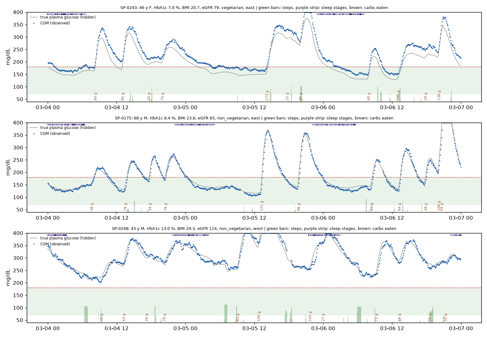
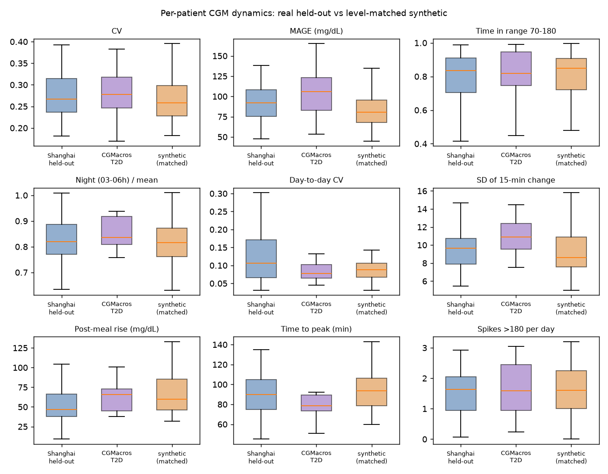
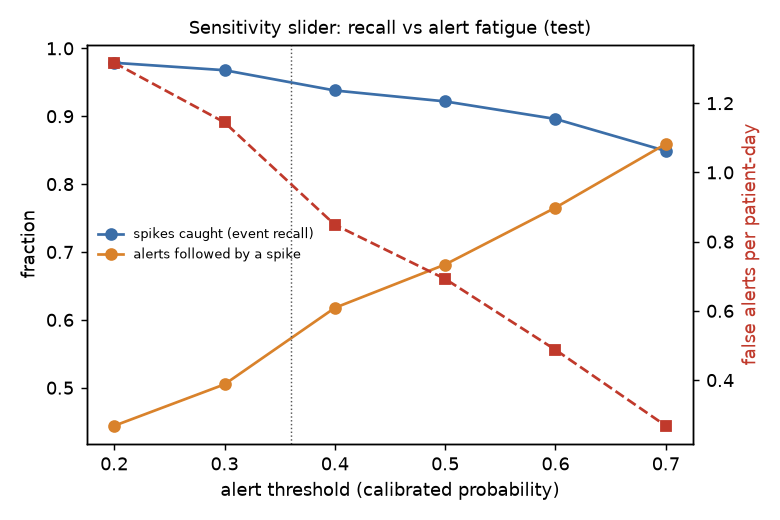
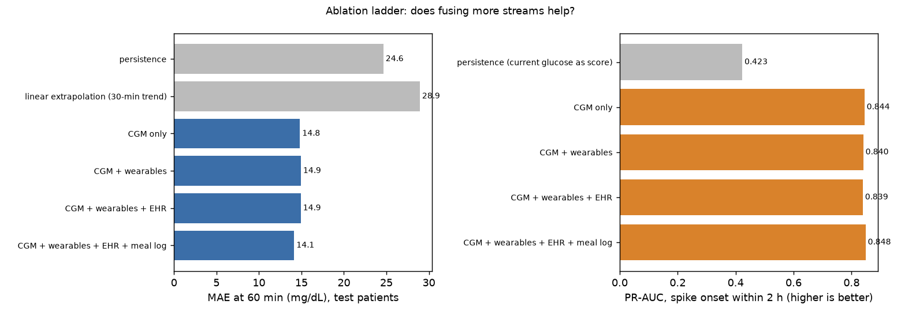
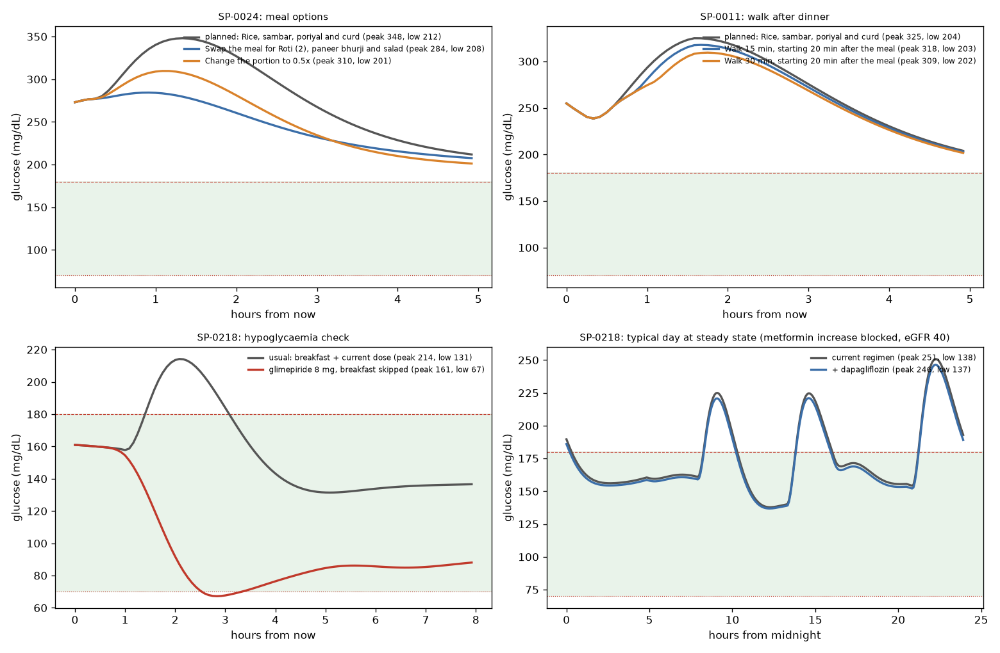

# T2D Digital Twin: a virtual Type 2 diabetes patient for 2-hour glucose-spike prediction and what-if simulation

**Digital Twin Challenge 2026 (Happiest Health)** · Team **AMRIT_VIT**

> Synthetic patients only. Decision support prototype, not a medical device.

| | |
|---|---|
| Team | AMRIT_VIT (one member): **Shashi Bhushan**, team leader, shashibhushanvijay@gmail.com |
| College | Vellore Institute of Technology (VIT), Vellore |
| Condition | Type 2 diabetes (India) |
| Status | Phases 1-4 complete (synthetic data + validation, prediction models + explanations, personalised what-if twin, dashboard); Phase 5 (submission package) next |
| Video | _link to be added (20+ minute recording)_ |
| Architecture diagram | _docs/architecture.pdf (Phase 5)_ |
| Presentation | _docs/presentation.pdf (Phase 5)_ |
| Licence | MIT (see [LICENSE](LICENSE)); third-party data keep their own licences (below) |

## Problem and healthcare use case

India has one of the world's largest populations with Type 2 diabetes, and many patients are diagnosed younger, at lower BMI, and with poorer glucose control than Western cohorts. A doctor in a busy clinic sees each patient for a few minutes, while continuous glucose monitors (CGM) and wrist wearables now produce thousands of readings a week that nobody has time to read.

This project builds a **digital twin** of a person with T2D: a virtual patient that fuses the **static record** (EHR: demographics, labs, medications, allergies, diet) with **dynamic streams** (CGM every 5 minutes, heart rate, HRV, sleep stages, steps) in order to:

1. **Predict a glucose spike about 2 hours ahead** (event detection with a calibrated probability, plus a forecast with an uncertainty band);
2. **Explain why** in clinical language (grouped SHAP drivers such as "large evening carbohydrate load" or "poor sleep last night");
3. **Let the doctor ask "what if?"** (swap dinner, add a post-meal walk, change a drug dose or timing) on a physiological model of that patient, with constraint checks (allergies, diet, kidney function) and a hypoglycaemia safety flag.

No real patient data is used anywhere (DPDP Act and HIPAA): the patients are simulated, and real open datasets are used only to calibrate and validate the simulator.

## How it works

```
 EHR cohort (copula) ──► hidden physiology ──► behaviour (Indian meals, walks, sleep, stress)
                              │                         │
                              ▼                         ▼
                    glucose-insulin ODE  ◄── meals, doses taken, exercise
                              │
                              ▼
                 sensor layer (CGM lag/noise/gaps, wearable artefacts)
                              │
        observed tables ──────┴────► models (Phase 2) ──► dashboard (Phase 4)
        truth tables (hidden) ─────► validation of data and explanations only
```

### Synthetic data generator (Phase 1, done)
- **Cohort layer** (`data_gen/cohort.py`): a Gaussian copula over age, BMI, waist, HbA1c, fasting glucose, diabetes duration, eGFR, ALT, lipids and blood pressure with Indian-clinic-style marginals; then fatty liver, comorbidities, allergies and intolerances, region and diet type (vegetarian, non-vegetarian, Jain), habits, a 12-month HbA1c history and medications (metformin, sulfonylureas, DPP-4 and SGLT2 inhibitors, basal insulin) assigned by eGFR-aware rules. No genetic fields.
- **Latent physiology / twin core** (`data_gen/physiology.py`): hidden insulin sensitivity, beta-cell function and hepatic glucose output derived from the record plus variation the record cannot explain; a hybrid Bergman / Dalla Man glucose-insulin ODE with meal absorption, insulin secretion (with incretin effect), hepatic output, renal glucose loss, counter-regulation, drug effects (metformin, sulfonylurea, DPP-4, SGLT2, glargine) and exercise. Each patient is anchored so their typical day matches their recorded HbA1c (with realistic scatter).
- **Behaviour layer** (`data_gen/behaviour.py`): 47 Indian meal "plates" (idli-sambar, rajma chawal, curd rice, biryani, poha...) filtered by diet, allergies and intolerances; meal timing with late dinners, weekend shifts and eating out; morning and post-meal walks, commuting; sleep architecture; stress and illness days; heart rate and HRV; imperfect medication taking; a partial, biased meal log.
- **Sensor layer** (`data_gen/sensors.py`): CGM interstitial lag (5-15 min), calibration error and drift, autocorrelated noise, 2-hour warm-up, dropouts, compression lows; wearable charging and off-wrist gaps, phantom steps, sleep-stage misclassification, noisy HRV.

The dataset (400 patients x 14 days) regenerates identically from one seed and is split 70/15/15 **by patient**.

### Prediction models and explanations (Phase 2, done)
- **Features** (`models/features.py`) are built only from what a clinic would observe up to the prediction time (a test changes the future and checks nothing earlier moves): CGM level, lags, trends, variability and excursion shape; steps, heart rate, last night's sleep and HRV; the patient's own meal log; the EHR record and prescription schedule.
- **Models** (`models/train.py`): persistence and linear-extrapolation baselines; an ablation ladder of LightGBM models (CGM only, + wearables, + EHR, + meal log); the fusion model with point and quantile forecasts at 15-120 min (80 % band widened by split-conformal calibration), a peak-glucose model, and a spike-onset classifier with isotonic calibration and an alert threshold chosen on validation patients.
- **Explanations** (`models/explain.py`): interventional TreeSHAP on the peak model against a reference cohort of similar patients, grouped into clinical concepts and rendered as templated sentences, with checks against the simulator's hidden truth.
- **Inference API** (`models/inference.py`): one small interface the dashboard will call.

### Personalised twin and what-if simulator (Phase 3, done)
- **Personalisation** (`twin/estimate.py`): starts from the physiology implied by the record, then fits insulin sensitivity, beta-cell function and the fasting set point to a week of the patient's own CGM and meal log.
- **What-if** (`twin/whatif.py`): swap or resize a meal (47 Indian dishes), add a walk, skip a meal, or change a dose. Each option is simulated for the next 5 hours from the twin's current state. Drug-regimen changes are compared as typical days at steady state.
- **Constraints** (`twin/constraints.py`): diet type, allergies, intolerances and eGFR drug limits are checked before anything is simulated, and blocked options show their reason.
- **Safety:** every result carries a hypoglycaemia check (below 70 mg/dL) and the patient's risk factors. It is labelled "Simulation for discussion with the patient, not a prescription."
- **Twin card** (`twin/card.py`): insulin sensitivity and secretion versus similar patients, with uncertainty, plus the patient's response to a standard meal.

### Doctor-facing dashboard (Phase 4, done)
`uv run streamlit run dashboard/app.py` (after `uv run python -m dashboard.prepare`). Four tabs:
- **Patient:** synthetic patient header with a red/amber/green alert chip, and one plain-language sentence, for example "Spike likely (90 %): above 180 in about 50 min, peak about 214 mg/dL (80 % range 193-263)". The main chart shows the last 24 h of CGM plus the 2-hour forecast with its band, and steps, heart rate, sleep stages and HRV sit on the same time axis. It also has "why this prediction" in clinical sentences, the record with allergy badges, and the twin state.
- **What-if:** meal swaps from the Indian dish library, portion changes, a walk, skipping a meal, or a medicine change, all simulated on the patient's personalised twin. Blocked options are listed with their reasons, and every result carries a hypoglycaemia check.
- **Triage:** every patient at the chosen clinic time, predicted lows first, then the highest predicted 2-hour peak, each with a one-line reason.
- **About this twin:** evaluation, real-data validation, what-if validation, limitations and data provenance.
- **Throughout:** an alert-sensitivity slider (showing the test-set catch rate and false alerts per day), a replay control that steps the twin forward, and "show what actually happened" for the demo. Three scripted demo scenes (a correct alert, a stable patient, and a moment where the model says it is unsure) are picked automatically from held-out days.

### Validation against real open data (Phase 1, done)
Real data is used **only** to calibrate seven population-level settings and to validate. It is never used to train the product models.
- Shanghai T2DM (Zhao et al., Scientific Data 2023; CC BY 4.0): split by patient into a calibration half and a held-out half.
- CGMacros T2D participants (PhysioNet; CC BY-NC-SA 4.0): external check, never used for tuning.

Results are in [`docs/validation_report.md`](docs/validation_report.md) (summary below).

## Results so far

Every number below comes from a pipeline run (dataset v0.1, seed 20261020). Details are in [`docs/validation_report.md`](docs/validation_report.md), [`docs/model_report.md`](docs/model_report.md) and [`docs/data_card.md`](docs/data_card.md). The models are trained and tested on synthetic patients, so their scores describe the simulated world and are an upper bound for real patients.

### Phase 1: a realistic synthetic cohort

**The dataset.** 400 patients × 14 days: 5,600 patient-days and 1.6 M CGM readings, 2.8 % of them missing. The simulated CGM has a MARD of 7.3 % against the hidden true glucose. Median time in range is 45 % at a median HbA1c of 8.3 %, and mean glucose follows the HbA1c-based estimate (ADAG).



**Glucose dynamics vs real T2D CGM (level-matched).** Real CGM in the open datasets sits well below the level HbA1c implies, because the recordings capture monitored, treated periods. So each real patient is compared with the synthetic patient whose mean glucose is closest.

On the held-out Shanghai half (49 patients), 12 of 14 compared metrics fall within half an interquartile range of the real median:

| metric | real | synthetic |
|---|---|---|
| CV | 0.27 | 0.26 |
| night/mean ratio | 0.82 | 0.82 |
| time to post-meal peak | 90 min | 93 min |
| spikes above 180 per day | 1.63 | 1.60 |

The two outside are MAGE (75 vs 92 mg/dL) and the fastest falls (5th percentile of 15-minute change: −11 vs −14 mg/dL).



**Train on synthetic, test on real (TSTR).** A CGM-only forecaster trained only on synthetic patients predicts real Shanghai glucose 60 minutes ahead with a MAE of 18.7 mg/dL. That beats persistence (19.9) and comes close to a model trained on real patients (17.5).

**Where the simulator still falls short.** A classifier can still tell real from synthetic 12-hour windows (AUC 0.95, level-matched). Real glucose falls faster after peaks: the median steepest 15-minute fall is −18 to −20 mg/dL, against −15 in the simulator.

### Phase 2: spike prediction and explanations (held-out test patients)

**Forecast.** The fusion model (CGM + wearables + EHR + meal log) has these errors:

| horizon | MAE | persistence MAE |
|---|---|---|
| 15 min | 4.8 mg/dL | |
| 60 min | 14.1 mg/dL | 24.6 mg/dL |
| 120 min | 22.7 mg/dL | 41.2 mg/dL |

At 60 minutes, 99.6 % of forecasts fall in Clarke zones A+B. The 80 % band covers 79 % of outcomes.

**Spike alerts** (onset above 180 mg/dL for 15 minutes or more within 2 hours):
- PR-AUC 0.848, AUROC 0.915, Brier 0.115.
- At the dashboard's default threshold (0.5), 92.2 % of spikes are caught, with a median lead time of 80 minutes and 0.69 false alert episodes per patient-day.
- A sensitivity slider trades catch rate against alert fatigue: 95.9 % caught at 1.0 false alerts per day (threshold 0.36), or 85 % caught at 0.27 per day (threshold 0.7).



**Does fusion help?** Differences are paired, with patient-level bootstrap 95 % intervals:
- **Meal log:** the clear winner. 60-minute MAE improves by 0.78 mg/dL [0.64, 0.90] and PR-AUC by 0.010.
- **Wearables:** slightly worse overall (MAE +0.11 [0.04, 0.19]), but they help where physiology says they should. Right after a walk, MAE improves by 0.90 mg/dL [0.24, 1.64].
- **EHR record:** no overall effect. It adds a small PR-AUC gain in a patient's first 24 hours, when CGM history is short.

The honest conclusion: with hours of CGM history, the glucose trace already carries most of what the record and the wearable tell you about today's physiology.



**Explanations.** SHAP on the predicted 2-hour peak is grouped into clinical concepts, measured against similar patients, and turned into sentences ([examples](docs/example_explanations.md)). Contributions sum exactly to the prediction. Checks against the simulator's hidden truth:
- After a logged meal of 60 g or more, "logged meals" is a top-3 driver 99.8 % of the time.
- Removing the top-3 concepts moves the prediction 19.5 mg/dL, against 5.6 for random ones.
- Similar moments get similar explanations: cosine similarity 0.75, against 0.04 for random pairs.

One check went the "wrong" way, and it teaches something. After a post-meal walk the model predicts a larger rise, and the data show why: glucose is temporarily suppressed while the meal is still being absorbed. SHAP describes what the model relied on, not the effect of an intervention. That is why what-if questions go to the ODE twin (Phase 3).

### Phase 3: the personalised twin and what-if (60 test patients)

**What the twin knows.** It uses only what a clinic holds: the record, prescriptions with reported adherence, CGM, steps and the patient's own meal log. It never reads the simulator's hidden values. A week of data personalises it; later days test it.

**What-if answers vs the truth.** Only synthetic data allows this check: each patient is replayed with the intervention applied to their true meals, doses and activity, and the result is compared with the twin's prediction. For a held-out dinner (50 patients), the error in the predicted change of the 5-hour peak was:

| intervention | median true change | personalised twin | record-only twin | cohort average |
|---|---|---|---|---|
| swap to a low-GI plate | −34 mg/dL | **13.1** | 16.2 | 31.0 |
| half portion | −45 mg/dL | 13.3 | **13.0** | 15.5 |
| skip the meal | −84 mg/dL | 27.1 | **25.8** | 34.7 |
| 20-min walk after the meal | −5 mg/dL | 3.3 | 3.3 | **2.7** |

**How good is it?**
- Both twins beat the cohort average for every meal change.
- The predicted change has the right direction for 94 % of patients (84 % for the swap).
- Personalisation clearly helps for the dish swap (Spearman 0.91).
- For resizing or skipping a meal, the record-based twin is just as good.
- Both under-estimate large cuts, because they see somewhat smaller meals than were eaten. The predicted dinner peak is 9 mg/dL too low on average.
- The effect of a walk is too small to predict usefully.

**Safety.** For 24 sulfonylurea users, the test scenario was "maximum dose, breakfast skipped". All 4 true lows were at least flagged "caution" (below 80 mg/dL), 1 of them as a predicted low, with no false alarms.

**Constraints first.** Options that conflict with diet, allergies, intolerances or kidney limits are never simulated, and they show the reason. For example: "Metformin 1000 → 2000 mg/day: BLOCKED, eGFR 40 (30-44): metformin limited to 1000 mg/day".



**What didn't work, and a bug found on the way.**
- **Parameter recovery.** Fitting the physiology parameters from a week of CGM and an incomplete meal log does not recover them better than the record-based estimate. The fit improves held-out prediction (CGM error 35 vs 40 mg/dL), so the twin card shows the values with their uncertainty.
- **Meal-absorption bug.** Building the dashboard exposed a bug: forward simulations dropped the absorption of meals already eaten. The fix cut the twin's peak bias from −32 to −9 mg/dL, and the validation above was re-run after it.

Details are in [`docs/twin_report.md`](docs/twin_report.md) and [`docs/twin_examples.md`](docs/twin_examples.md).

## Repository layout

```
configs/        YAML configs; literature values carry {source, verified} tags
common/         seeding, config loading, units (ADAG, GMI, CKD-EPI 2021), deterministic I/O
data_gen/       cohort, physiology (ODE twin core), behaviour, sensors, generate, describe
validation/     real-data download and loaders, metrics, level-matched comparison,
                calibration, discriminator, TSTR, report
models/         Phase 2: features, baselines, LightGBM fusion, calibration, SHAP
twin/           Phase 3: what-if simulator (constraints, safety checks)
dashboard/      Phase 4: Streamlit + Plotly
docs/           decisions, data dictionary, data card, validation report, review lists, tasks
results/        metrics and figures produced by the pipeline (only numbers from actual runs)
tests/          one test module per layer + determinism and leakage tests
```

## Setup and run

Requires Python 3.12 and [uv](https://docs.astral.sh/uv/).

```bash
uv sync                                          # create the environment from uv.lock
uv run python -m data_gen.generate               # build the synthetic dataset (about 1 minute)
uv run pytest                                    # run the tests
uv run python -m validation.real_data.download   # fetch the real validation data (about 47 MB)
uv run python -m validation.calibrate            # optional: re-run the calibration search
uv run python -m validation.report               # validation report and figures
uv run python -m data_gen.describe               # data dictionary and data card
uv run python -m common.provenance               # list of literature values still to verify
uv run python -m models.features                 # Phase 2: build model features (about 1 minute)
uv run python -m models.train                    # train ladder + fusion models, write results/models (about 8 minutes)
uv run python -m models.explain                  # explanations and their checks
uv run python -m models.report                   # docs/model_report.md
uv run python -m twin.validate                   # Phase 3: personalise + validate the twin on test patients (about 1 hour)
uv run python -m twin.report                     # docs/twin_report.md
uv run python -m twin.examples                   # worked what-if examples and plots
uv run python -m dashboard.prepare               # Phase 4: build the dashboard's demo cache (about 2 minutes)
uv run streamlit run dashboard/app.py            # open the dashboard at http://localhost:8501
```

## Responsible-data notes (DPDP-aware design)
- No personal data is collected, stored or processed: every patient is simulated.
- Real open datasets stay outside the repository (`data/real/` is gitignored); only download scripts are shared, and licences are respected (CGMacros is non-commercial, share-alike).
- Hidden simulator state is stored separately from what a clinic would observe, and tests check that no hidden field leaks into model inputs.
- Every assumption taken from literature is tagged and listed for verification; nothing is presented as a clinical fact until checked.
- The dashboard will always show "Synthetic patient. Decision support only."

## Limitations
- Simulated physiology encodes our assumptions; models trained on it can partly rediscover them (circularity). Hidden variation and validation on real CGM reduce but do not remove this. Performance on synthetic data is an upper bound.
- The real validation datasets are not Indian and are small (tens of patients); their CGM reflects monitored, treated periods.
- Indian population values, meal macros and drug rules are unverified assumptions awaiting checks (`docs/parameters_to_verify.md`, `docs/clinical_rules_to_review.md`).

## Future work
- Genetic risk and pharmacogenomic markers (deliberately out of scope for this prototype).
- Calibrate against an Indian CGM cohort if an open one becomes available; prandial and premixed insulin; GLP-1 receptor agonists.

## Data sources and licences
- Shanghai T2DM / T1DM datasets: Zhao Q. et al., "Chinese diabetes datasets for data-driven machine learning", Scientific Data (2023); figshare, CC BY 4.0.
- CGMacros v1.0.0: PhysioNet, CC BY-NC-SA 4.0.
