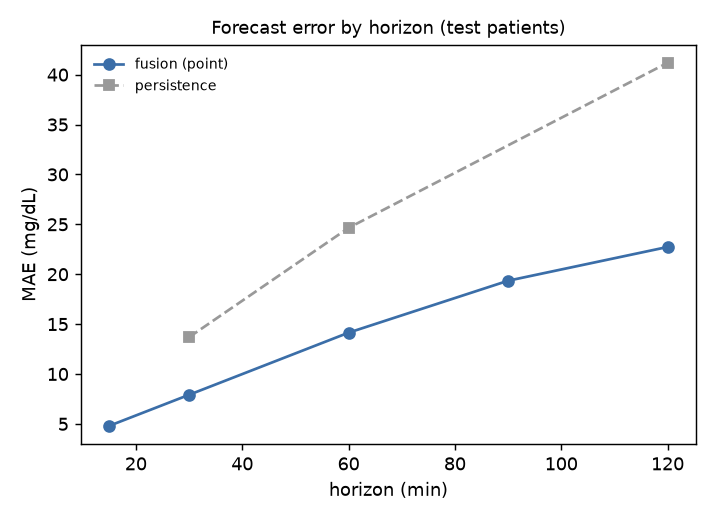
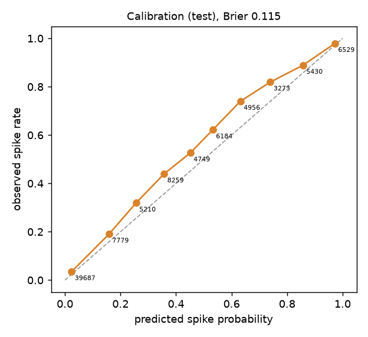
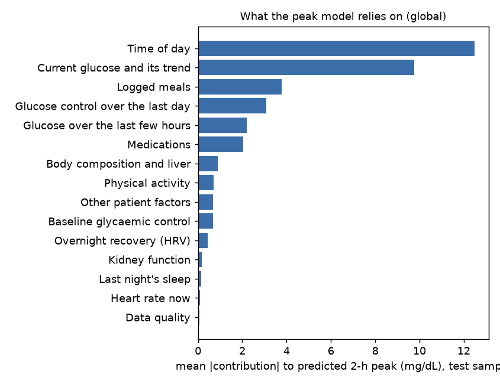
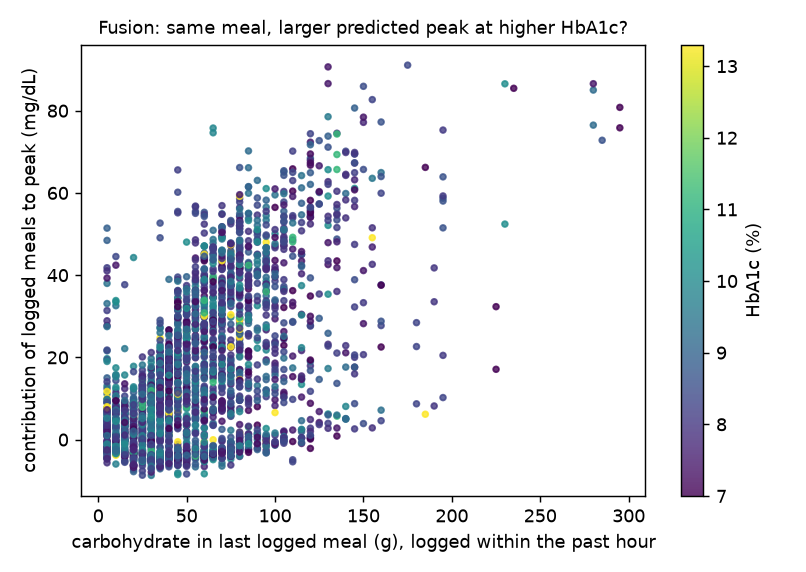

# Model report (Phase 2)

_Generated by `uv run python -m models.report` from `results/models/` and `results/explain/`. All numbers are from held-out **test patients** (patient-wise split; 230,609 prediction times every 5 minutes). Synthetic data only: these results describe performance in the simulated world and are an upper bound for real patients (see the data card)._

## Task
- **Forecast** CGM glucose 15-120 minutes ahead, with an 80 % band.
- **Detect** a spike: from a moment at or below 180 mg/dL, CGM above 180 for at least 15 minutes within the next 2 hours (decision D-004). Prevalence among eligible test moments: 34.9 %.
- Models: LightGBM on features built only from data up to the prediction time (a test checks this). Validation patients choose early stopping, isotonic calibration, the conformal band width and the alert threshold.

## Ablation ladder: does fusion help?

| model | MAE 30 min | MAE 60 min | MAE 120 min | RMSE 30 min | RMSE 60 min | RMSE 120 min |
|---|---|---|---|---|---|---|
| persistence | 13.69 | 24.64 | 41.19 | 20.62 | 36.26 | 55.9 |
| linear extrapolation (30-min trend) | 13.13 | 28.93 | 65.13 | 19.72 | 43.79 | 95.33 |
| CGM only | 8.34 | 14.82 | 22.96 | 12.36 | 22.94 | 33.31 |
| CGM + wearables | 8.34 | 14.93 | 23.22 | 12.37 | 23.04 | 33.56 |
| CGM + wearables + EHR | 8.34 | 14.92 | 23.14 | 12.39 | 23.12 | 33.58 |
| CGM + wearables + EHR + meal log | 7.91 | 14.14 | 22.73 | 11.74 | 21.94 | 33.14 |

| model | pr_auc | auroc | brier | prevalence |
|---|---|---|---|---|
| persistence (current glucose as score) | 0.423 | 0.578 | 0.224 | 0.349 |
| CGM only | 0.844 | 0.915 | 0.116 | 0.349 |
| CGM + wearables | 0.84 | 0.914 | 0.117 | 0.349 |
| CGM + wearables + EHR | 0.839 | 0.912 | 0.118 | 0.349 |
| CGM + wearables + EHR + meal log | 0.848 | 0.915 | 0.115 | 0.349 |

Going from CGM only to the full fusion model changes 60-minute MAE by -0.68 mg/dL and spike PR-AUC by +0.004.

**Paired differences with patient-level bootstrap 95 % intervals** (negative MAE change and positive PR-AUC change mean the added stream helps; an interval that crosses zero means no clear effect). Strata: all test times; the first 24 h of each patient's data (short CGM history); the first 3 h after waking (the day's sleep and stress not yet visible in glucose); right after a walk (exercise effect).

| stratum | step | test rows | change in 60-min MAE (mg/dL) [95 % CI] | change in spike PR-AUC [95 % CI] |
|---|---|---|---|---|
| all test times | CGM -> +wear | 230,609 | +0.11 [+0.04, +0.19] | -0.0041 [-0.0076, -0.0003] |
| all test times | +wear -> +EHR | 230,609 | -0.01 [-0.09, +0.07] | -0.0016 [-0.0063, +0.0033] |
| all test times | +EHR -> +meal log | 230,609 | -0.78 [-0.90, -0.64] | +0.0096 [+0.0041, +0.0146] |
| all test times | CGM -> +meal log | 230,609 | -0.68 [-0.84, -0.55] | +0.0039 [-0.0022, +0.0107] |
| first 24 h of data | CGM -> +wear | 12,798 | +0.18 [-0.00, +0.37] | -0.0020 [-0.0103, +0.0069] |
| first 24 h of data | +wear -> +EHR | 12,798 | +0.04 [-0.27, +0.31] | +0.0096 [+0.0002, +0.0203] |
| first 24 h of data | +EHR -> +meal log | 12,798 | -1.05 [-1.39, -0.79] | +0.0060 [-0.0001, +0.0157] |
| first 24 h of data | CGM -> +meal log | 12,798 | -0.83 [-1.21, -0.49] | +0.0137 [+0.0042, +0.0234] |
| within 3 h of waking | CGM -> +wear | 27,052 | +0.11 [-0.10, +0.27] | -0.0061 [-0.0182, +0.0080] |
| within 3 h of waking | +wear -> +EHR | 27,052 | -0.07 [-0.27, +0.13] | +0.0003 [-0.0140, +0.0137] |
| within 3 h of waking | +EHR -> +meal log | 27,052 | -0.97 [-1.22, -0.75] | +0.0053 [-0.0078, +0.0201] |
| within 3 h of waking | CGM -> +meal log | 27,052 | -0.93 [-1.20, -0.63] | -0.0005 [-0.0202, +0.0178] |
| after a walk (>= 1500 steps in 30 min) | CGM -> +wear | 2,679 | -0.90 [-1.64, -0.24] | +0.0028 [-0.0103, +0.0147] |
| after a walk (>= 1500 steps in 30 min) | +wear -> +EHR | 2,679 | +0.24 [-0.16, +0.61] | -0.0012 [-0.0150, +0.0146] |
| after a walk (>= 1500 steps in 30 min) | +EHR -> +meal log | 2,679 | -1.09 [-1.59, -0.45] | +0.0187 [-0.0028, +0.0498] |
| after a walk (>= 1500 steps in 30 min) | CGM -> +meal log | 2,679 | -1.74 [-2.57, -1.01] | +0.0203 [-0.0047, +0.0515] |

What the intervals say (only effects whose 95 % interval excludes zero are listed):

- **Adding wearables:** all test times: 60-min MAE +0.11 mg/dL (worse); all test times: spike PR-AUC -0.004 (worse); after a walk (>= 1500 steps in 30 min): 60-min MAE -0.90 mg/dL (better).
- **Adding the EHR record:** first 24 h of data: spike PR-AUC +0.010 (better).
- **Adding the meal log:** all test times: 60-min MAE -0.78 mg/dL (better); all test times: spike PR-AUC +0.010 (better); first 24 h of data: 60-min MAE -1.05 mg/dL (better); within 3 h of waking: 60-min MAE -0.97 mg/dL (better); after a walk (>= 1500 steps in 30 min): 60-min MAE -1.09 mg/dL (better).

## Fusion model (CGM + wearables + EHR + meal log)

| horizon_min | mae | rmse | clarke_A | clarke_B | clarke_D | band_coverage | band_width_median |
|---|---|---|---|---|---|---|---|
| 15 | 4.808 | 6.686 | 0.999 | 0.001 | 0 | 0.79 | 13.8 |
| 30 | 7.914 | 11.738 | 0.99 | 0.009 | 0.001 | 0.789 | 21.189 |
| 60 | 14.14 | 21.944 | 0.941 | 0.055 | 0.004 | 0.785 | 35.294 |
| 90 | 19.345 | 29.211 | 0.885 | 0.108 | 0.007 | 0.788 | 50.385 |
| 120 | 22.728 | 33.144 | 0.844 | 0.148 | 0.008 | 0.786 | 63.295 |
| peak in next 120 | 16.432 | 28.003 |  |  |  |  |  |

`band_coverage` is the share of test outcomes inside the 80 % band (target 0.80, set on validation patients by split-conformal widening of quantile models). Clarke zones A+B are clinically acceptable; D means a missed high or low.

### Spike alerts

Operating point chosen on validation patients (maximum F1): probability >= **0.36**.

| measure (test) | value |
|---|---|
| PR-AUC / AUROC | 0.848 / 0.915 |
| Brier score (calibrated) | 0.115 |
| precision / recall per prediction time | 0.730 / 0.812 |
| spike onsets caught (alert in the 2 h before) | 1668 of 1740 (95.9 %) |
| lead time, median (mean) | 95 min (84 min) |
| alert episodes followed by a spike | 55.9 % |
| false alert episodes per patient-day | 1.01 |

 

Calibration on test patients: expected calibration error 0.039; largest gap in the bin around 0.63 predicted vs 0.74 observed (probabilities slightly too low on average; isotonic calibration was fitted on the validation patients).

Sensitivity slider (what the dashboard offers; a higher threshold means fewer, more certain alerts):

| threshold | precision | recall | event_recall | median_lead_time_min | episode_precision | false_alerts_per_patient_day |
|---|---|---|---|---|---|---|
| 0.2 | 0.655 | 0.91 | 0.979 | 115 | 0.444 | 1.317 |
| 0.3 | 0.699 | 0.859 | 0.968 | 105 | 0.505 | 1.145 |
| 0.4 | 0.768 | 0.745 | 0.938 | 90 | 0.618 | 0.849 |
| 0.5 | 0.812 | 0.667 | 0.922 | 80 | 0.682 | 0.692 |
| 0.6 | 0.87 | 0.548 | 0.896 | 60 | 0.765 | 0.487 |
| 0.7 | 0.913 | 0.433 | 0.849 | 45 | 0.859 | 0.268 |

## Explanations (SHAP on the peak-glucose model)

Contributions are in mg/dL of predicted 2-hour peak, relative to similar training patients (age +-10 y, diabetes duration +-5 y), grouped into clinical concepts and shown as sentences (examples: [`docs/example_explanations.md`](example_explanations.md)). They describe what the model relied on, not what would happen if something changed; what-if answers come from the ODE twin.

 

**Checks against the simulator's hidden truth** (validation against the simulated world only):

| check | group A | group B | mean A (mg/dL) | mean B (mg/dL) | expected | direction ok | p (Mann-Whitney) |
|---|---|---|---|---|---|---|---|
| logged meal | large meal (>= 60 g) logged within 45 min (n=922) | no meal logged in the last 4 h (daytime) (n=11296) | +36.7 | -1.5 | a > b | yes | 0 |
| activity | >= 1500 steps in the last hour, 30-120 min after a logged meal (n=198) | <= 300 steps, same post-meal window (n=2676) | +0.8 | +0.3 | b > a | NO | 2e-19 |
| sleep | hidden sleep < 5.5 h last night (n=2373) | hidden sleep >= 7.5 h (n=5912) | +0.4 | +0.1 | a > b | yes | 1e-106 |
| insulin resistance | hidden insulin sensitivity, lowest third (n=1817) | highest third (daytime, glucose 120-180) (n=2363) | -0.1 | +0.6 | a > b | NO | 5.7e-19 |

- **Activity (opposite to the naive expectation):** after a post-meal walk the current glucose is already lower (median 214 vs 237 mg/dL) and the actual rise to the 2-hour peak is larger (median 29 vs 13 mg/dL, n=1570 vs 19816): the walk suppresses glucose for a while and the rest of the meal is still being absorbed. The model learned that rebound, so 'recent walking' raises the predicted rise from the current reading. This is the clearest example of why SHAP is never shown as the effect of an intervention; 'what if the patient walks' is answered by the ODE twin.
- **Insulin resistance:** record-based concepts carry little weight in this model (mean |contribution| of all EHR concepts together 4.5 mg/dL), and the contrast goes the wrong way by less than 1 mg/dL. The model reads the patient's physiology from the CGM history instead, matching the ablation (EHR adds no accuracy). The dashboard therefore shows record factors in the twin-state and profile panels rather than as alert drivers.

- **Top-driver agreement:** after a logged meal of 60 g or more within 45 minutes, 'logged meals' is among the top-3 upward concepts in 100 % of cases (n=922).
- **Deletion test:** neutralising the top-3 concepts moves the prediction by 19.5 mg/dL on average, vs 5.6 for 3 random concepts; expected vs actual change correlate at 0.97.
- **Fusion interaction (meal x HbA1c):** for logged meals of 40-100 g within the hour, the meal's contribution changes by +0.30 mg/dL per 1 % HbA1c (vs +3.3 per 10 g carbohydrate; n=1525). The model barely scales the meal effect by HbA1c; the patient-specific response is carried by the CGM history instead (see the dependence plot).
- **Consistency:** explanations of similar moments in different patients have cosine similarity 0.75, vs 0.04 for random pairs.
- **Clinician review:** pending (the example sentences are written for that review).

## Limitations
- Trained and tested on synthetic patients; the simulator's assumptions are partly learnable by the model (circularity, see the data card). The real-data TSTR check in `docs/validation_report.md` is CGM-only.
- Time-of-day features learn the synthetic Indian meal schedule; they will not transfer to a different schedule without retraining.
- The same validation patients drive early stopping and calibration (a separate calibration split would be cleaner).
- Alerts are evaluated per 5-minute prediction; the dashboard adds a 60-minute refractory period to limit repeats.
