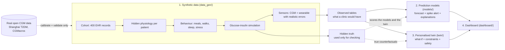

# Project guide: how the T2D digital twin works, and how to present it

This guide explains the whole project in order, in plain language: the problem, where the data come from and why, how the prediction models and the twin work, what every part of the dashboard means, and how to present each part in the video. Every number is taken from the pipeline's results files (dataset v0.1, seed 20261020); the detailed reports are linked in each section.

---

## 0. The big picture in one minute

We built a **digital twin** of a person with Type 2 diabetes: a virtual copy of the patient that

1. **combines** their static medical record (age, HbA1c, kidney function, medicines, allergies, diet) with their continuous data streams (a CGM glucose reading every 5 minutes, steps, heart rate, sleep, heart-rate variability, and the meals they log);
2. **predicts** whether their glucose will spike above 180 mg/dL in the next 2 hours, with a forecast curve and an uncertainty range;
3. **explains** the prediction in clinical sentences ("logged meal of about 80 g carbohydrate 1 min ago: +37 mg/dL");
4. **lets the doctor ask "what if?"**: swap the dinner, add a walk, change a dose, and see the simulated effect on this patient, with safety checks.

Because real patient data cannot be used (DPDP Act, HIPAA), every patient is **synthetic**, generated by a simulator we built and checked against real open CGM data.

---

## 1. The problem and the healthcare use case

**The situation in India.** India has one of the largest numbers of people with Type 2 diabetes in the world. Many are diagnosed younger and at a lower body weight than in Western countries, and many have poor glucose control (our synthetic cohort mirrors this with a median HbA1c of 8.3 %).

**The doctor's problem.** A diabetologist in a busy clinic has a few minutes per patient. Continuous glucose monitors (CGM) and wrist wearables now produce about 2,000 glucose readings a week per patient plus heart rate, steps and sleep. Nobody has time to read that.

**What is missing.**
- **Early warning:** knowing *before* a glucose spike that one is coming, so the patient can act (walk, adjust the meal).
- **Explanation:** *why* the spike is predicted, in words a doctor trusts.
- **Safe experimentation:** trying a change (a different dinner, a dose change) on a virtual copy of the patient before trying it on the real one.

**Why a "digital twin".** A forecaster only predicts. A twin also keeps a personalised model of the patient's physiology, so it can answer "what if?" questions, which a statistical model cannot do reliably (section 5 shows an example where it would give the wrong answer).

**Scope decisions** (from the brief and `CLAUDE.md`): one condition (Type 2 diabetes); prediction target = glucose above 180 mg/dL for at least 15 minutes, starting within the next 2 hours, from a moment at or below 180 (decision D-004 in `docs/decisions.md`); no genetic data; synthetic data only.

**How to say it in the video (about 2 minutes):** "Doctors get thousands of glucose readings per patient and a few minutes to look at them. We built a virtual patient that watches the streams, warns about a spike about an hour and a half before it happens, explains why in clinical words, and lets the doctor safely test a change on the virtual patient first. Everything runs on synthetic patients, so no real person's data is used."

---

## 2. The data: how we "collected" it and why

### 2.1 Why synthetic data

The brief allows only anonymised, open or synthetic data. Real patient data would raise DPDP/HIPAA issues, and open Indian CGM datasets with records and wearables do not exist. So we **generated** the patients, and used real open data only to make the generator realistic and to test it.

### 2.2 The generator: four layers (`data_gen/`)

Think of it as building a patient from the inside out.

| Layer | File | What it creates | Why it matters |
|---|---|---|---|
| 1. Cohort (the medical record) | `cohort.py` | 400 patients: age, sex, BMI, waist, HbA1c and its 12-month history, fasting glucose, diabetes duration, kidney function (eGFR, creatinine), liver (ALT, fatty liver), lipids, blood pressure, conditions, food/drug allergies and intolerances, region and diet type (vegetarian, non-vegetarian, Jain), activity level, medicines with doses and times, reported adherence | This is the "static stream" of the brief. The values are drawn together (Gaussian copula) so they are correlated realistically: higher BMI goes with bigger waist, older age with lower kidney function. Medicines follow kidney rules (no metformin below eGFR 30). |
| 2. Hidden physiology | `physiology.py` | For each patient, hidden numbers: insulin sensitivity, beta-cell (insulin-making) function, liver glucose output, how fast food is absorbed, response to each drug | These are what really drive the patient's glucose. They come from the record **plus random variation the record cannot explain**, so the models cannot simply read the answer off the record. |
| 3. Behaviour | `behaviour.py` | 14 days of life per patient: meals from a library of 47 Indian dishes (idli-sambar, rajma chawal, curd rice, biryani, poha...) filtered by diet and allergies, meal times with late Indian dinners, weekend shifts, eating out; morning and post-meal walks; sleep stages; stress and illness days; heart rate and HRV; missed medicine doses; and the patient's own meal log (about 55 % of meals logged, carbohydrates under-estimated) | This is the "dynamic stream": real life is messy, so the behaviour varies day to day. Sleep and stress also change insulin sensitivity the next day, which gives the wearables something real to detect. |
| 4. Sensors | `sensors.py` | What the devices record: CGM every 5 minutes with a 5-15 min lag behind blood glucose, calibration error, drift, noise, warm-up gaps, dropouts, false lows while lying on the sensor; wearables with charging gaps, phantom steps, sleep-stage misclassification | Real devices are imperfect; a model trained on perfect data would fail on real data. Our simulated CGM error (MARD) is 7.3 %, in the range of real sensors. |

In between, a **glucose-insulin simulation** (a set of equations called an ODE, based on the published Bergman and Dalla Man models) turns meals, medicines and walks into a minute-by-minute blood glucose curve for each patient. Each patient is tuned so that their average glucose roughly matches their recorded HbA1c (with realistic scatter).

**Two kinds of output.** The generator writes two folders:
- `observed/` = what a clinic would actually have (record, CGM, wearables, meal log). **The models and the twin only ever read this.**
- `truth/` = hidden simulator state (true meals eaten, true insulin sensitivity, doses actually taken). **Used only to check** the models and the twin. A test fails if any hidden field leaks into the observed tables.

**Size and reproducibility.** 400 patients x 14 days = 5,600 patient-days and 1.6 million CGM readings, generated in about a minute from one fixed seed; running it again gives identical files (checked by a test). Details: `docs/data_card.md`, every field in `docs/data_dictionary.md`.

**Every field has a job** (from the brief's schema): *modifiers* change the physiology (HbA1c, BMI, liver, kidney, medicines); *constraints* limit the what-if options (allergies, diet, eGFR drug limits); *context* explains without changing the maths (lipids, blood pressure).

### 2.3 The real data: used only to calibrate and test (`validation/`)

| Dataset | What it is | Licence | How we used it |
|---|---|---|---|
| Shanghai T2DM (Zhao et al., Scientific Data 2023) | 100 Chinese T2D patients, 15-minute CGM, meals, medicines, labs | CC BY 4.0 | Split by patient: 48 to tune 7 population settings of the generator, 49 held out to test it |
| CGMacros (PhysioNet) | 14 US participants with T2D, CGM plus logged meals with macros | CC BY-NC-SA 4.0 | Never used for tuning; an external check |

The real data are downloaded by a script into `data/real/` (not part of the repository) and are **never used to train** the prediction models.

**An important finding.** In both real datasets, the CGM during the study is far lower than the patients' HbA1c implies: in Shanghai, median CGM 142 mg/dL against about 194 expected from HbA1c. Those recordings capture a monitored, treated period. Our cohort represents Indian outpatients whose HbA1c is current, so we did not copy that low level; we compared **glucose behaviour between real and synthetic patients with the same average glucose** ("level-matched").

**What the checks show** (`docs/validation_report.md`):
- On the 49 held-out Shanghai patients, 12 of 14 glucose-behaviour measures fall within half the real spread: variability (CV) 0.26 synthetic vs 0.27 real, time in range 83 % vs 84 %, night-time level relative to the mean 0.82 vs 0.82, time from meal to peak 93 vs 90 min, spikes per day 1.60 vs 1.63.
- **Train on synthetic, test on real (TSTR):** a simple forecaster trained only on our synthetic patients predicts real Shanghai glucose 60 minutes ahead with an error of 18.7 mg/dL, better than "no change" (19.9) and close to a model trained on real patients (17.5).
- **Honest gap:** a classifier can still tell real and synthetic 12-hour windows apart (AUC 0.95); the main cue is that real glucose falls faster after a peak than our simulator's.

**How to say it in the video (about 4 minutes):** "We could not use real patients, so we built them. Each synthetic patient has a medical record, a hidden physiology, a daily life with Indian meals, walks and sleep, and imperfect devices. The models only see what a clinic would see; the hidden truth is kept aside to check them. To make sure the patients are realistic, we compared them with real open CGM data from 100 patients in Shanghai and 14 in the US. Show `results/validation/matched_distributions.png`: the synthetic curves behave like real ones on 12 of 14 measures. And a model trained only on our synthetic patients works on real patients almost as well as one trained on real data. We are also honest about what is not yet realistic: real glucose drops faster after a meal."

---

## 3. The prediction models (`models/`)

**What the model sees at each moment** (only data up to that moment; a test checks that changing the future never changes a feature):
- **CGM history:** current glucose, the last 2 hours of readings, trends, variability, the last 3, 6 and 24 hours;
- **wearables:** steps in the last 15-120 minutes, heart rate, last night's sleep and HRV;
- **meal log:** time and carbohydrate estimate of the last logged meal;
- **record:** HbA1c, BMI, kidney function, medicines and the time since each scheduled dose.

**What it predicts** (LightGBM, a fast tree-based model):
- glucose 15, 30, 60, 90 and 120 minutes ahead, with an **80 % range** (the range contains the true value about 79 % of the time on test patients);
- the **highest glucose in the next 2 hours** (this is what the explanations describe);
- the **probability of a spike**, calibrated so that "70 %" means roughly 70 %.

**How it was tested.** Patients were split 70/15/15 **by patient** (a patient is never in both training and testing). Every number below is from the 60 test patients the model never saw (`docs/model_report.md`):

| Measure | Result |
|---|---|
| Error 15 / 60 / 120 minutes ahead | 4.8 / 14.1 / 22.7 mg/dL (assuming "no change" gives 24.6 at 60 min) |
| Forecasts in clinically acceptable Clarke zones A+B at 60 min | 99.6 % |
| Spike detection | PR-AUC 0.848, AUROC 0.915, calibration (Brier) 0.115 |
| At the dashboard default threshold 0.5 | 92 % of spikes caught, median warning 80 minutes ahead, 0.69 false alerts per patient per day |

**Does combining the streams help? (the ablation ladder)** We trained the model with CGM only, then added wearables, then the record, then the meal log. Honest answer:
- the **meal log** clearly helps (60-minute error 0.78 mg/dL lower);
- **wearables** do not help on average, but they do right after a walk (0.90 mg/dL better);
- the **record** helps spike detection in a patient's first day, when there is little glucose history.
When hours of CGM history exist, the glucose trace already shows most of what the record and wearables would say.

**Explanations (SHAP).** SHAP splits each prediction into contributions of the inputs, in mg/dL, relative to *similar patients* (same age band and diabetes duration). We group the inputs into clinical concepts ("logged meals", "last night's sleep", "current glucose and its trend") and turn them into sentences; the doctor never sees internal variable names (a test checks this). Checks: after a large logged meal, "logged meals" is among the top three drivers 99.8 % of the time; removing the top three drivers moves the prediction 19.5 mg/dL vs 5.6 for three random ones.

**How to say it in the video (about 3 minutes):** "The model reads the last hours of CGM, the wearable, the meal log and the record, and predicts the next two hours. On patients it never saw, it catches 92 % of spikes, about 80 minutes ahead, with fewer than one false alert per patient per day. Show `results/models/ablation.png`: the meal log is what really helps; wearables help right after a walk. And every alert comes with the reasons, in clinical words."

---

## 4. Why a separate physiological twin, and how it works (`twin/`)

**Why not just use the prediction model for "what if"?** Because explanations describe what the model *relied on*, not what would *happen*. Real example from our checks: after a walk, the model predicts a *bigger* rise, because the walk temporarily lowered glucose while the meal was still being absorbed. If a doctor read that as "walking raises glucose", it would be wrong. So what-if answers come from a model of the body, not from the forecaster.

**How the twin is personalised.** The twin uses the glucose-insulin equations, but knows only what a clinic knows: record, prescriptions, CGM, steps and the meal log. It starts from what the record implies (for example "HbA1c 9 % and BMI 28 suggest low insulin sensitivity") and then adjusts insulin sensitivity, insulin production and the fasting level so that it reproduces the patient's first 7 days of CGM. Unlogged meals are filled in where CGM rises with no log.

**What-if types:** swap a dish (from the 47-dish Indian library), change the portion, skip a meal, add a walk, change a medicine (for the next hours, or a typical day once the new dose has settled).

**Before simulating: constraint checks.** Options that conflict with the patient are **blocked with the reason**: non-vegetarian dishes for a vegetarian, onion/garlic dishes for a Jain patient, peanut dishes for a peanut allergy, metformin above 1000 mg/day when eGFR is 30-44. Some are allowed with a **warning**: sulfonylurea at age 65+ or low eGFR (hypoglycaemia risk). All rules are listed for clinical review in `docs/clinical_rules_to_review.md`.

**After simulating: safety check.** Every result says whether the simulated glucose drops below 70 mg/dL (red "predicted low") or below 80 ("caution"), and lists the patient's risk factors (older age, low eGFR, sulfonylurea or insulin).

**How it was tested (only possible with synthetic data).** For 50 test patients we replayed their real synthetic day with the intervention applied to their *true* meals and doses, and compared with the twin's answer (`docs/twin_report.md`):

| Intervention | True change in 5-hour peak (median) | Twin's error | Using the cohort average instead |
|---|---|---|---|
| Swap to a low-GI dish | -34 mg/dL | 13.1 | 31.0 |
| Half portion | -45 mg/dL | 13.3 | 15.5 |
| Skip the meal | -84 mg/dL | 27.1 | 34.7 |
| 20-min walk | -5 mg/dL | 3.3 | 2.7 |

The twin gets the direction of the change right for 84-94 % of patients depending on the change, and personalisation clearly helps for dish swaps. A walk's effect is too small to predict usefully. In the safety test (24 sulfonylurea users, maximum dose and breakfast skipped) all 4 real lows were at least flagged "caution", with no false alarms.

**How to say it in the video (about 2-3 minutes):** "For 'what if' we do not trust the prediction model, because explanations are not cause and effect. Instead each patient has a personalised physiological twin, fitted on their first week of data. Before it simulates anything it checks the patient's allergies, diet and kidney limits; after, it checks for low glucose. We tested it against the true outcome of each change on 50 patients: for a dish swap, its error is 13 mg/dL, against 31 if you just used the average effect."

---

## 5. The dashboard, component by component (`dashboard/`)

Start it with `uv run streamlit run dashboard/app.py` and open http://localhost:8501. It has a sidebar and four tabs.

### 5.1 Always visible

| Component | What it means | How to present it |
|---|---|---|
| **Yellow banner** "Synthetic patient. Decision support only." | Every patient is simulated; the tool supports the doctor's decision, it does not make it. | Point at it once at the start: "This is always on screen: synthetic patients, decision support only." |
| **Sidebar: Demo scene** | Three prepared situations picked automatically from days the models never trained on: 1) correct alert after a meal, 2) stable patient, 3) the model is unsure. "Free exploration" lets you pick any of the 60 test patients. | "I have three scripted scenes, plus free exploration of 60 patients." Read the grey story text under the selector. |
| **Sidebar: Patient / Day / Time, and -1 h, +15 min, +1 h** | Moves "now". Everything on screen is recomputed as if the doctor opened the record at that moment; no future data is used. | Use +15 min to show the forecast updating. |
| **Replay the next 2 hours** | Plays the next 2 hours in 15-minute steps: chip, sentence and chart update like a live feed. | "This is how it would look live." Use it in scene 1. |
| **Show what actually happened (replay)** | Draws the real CGM after "now" as a grey dotted line. Only possible in a demo, to prove the forecast. | Turn it on after an alert: "and here is what actually happened." |
| **Alert sensitivity slider** | The probability threshold for an alert. Lower = catches more spikes but more false alerts. The grey text shows the real test-set numbers for the chosen setting. | Move it from 0.5 to 0.3 and to 0.7 and read the text: "the doctor chooses between catching more spikes and alert fatigue." |

### 5.2 Patient tab

| Component | What it means | How to present it |
|---|---|---|
| **Header**: patient ID, age, sex, diabetes duration, HbA1c with 12-month arrow, eGFR, glucose-lowering medicines | The 5-second summary of who this is. | Read it aloud quickly. |
| **Alert chip** (red / amber / green) | Red = "Spike alert" (probability at or above the threshold) or "Low glucose risk" (the 80 % range dips below 70). Amber = "High now" (above 180 already) or "Watch" (probability 30 % or more). Green = "Stable". Only these three colours are used for risk. | "Red, amber, green, nothing else, so the eye goes straight to risk." |
| **Blue sentence** | The forecast in words, e.g. "Spike likely (90 %): above 180 in about 50 min, peak about 214 mg/dL (80 % range 193-263)." When the model is unsure it says so: "The model is uncertain here: ...". | Read it aloud: this is the one line a busy doctor reads. |
| **Data-quality chip** (when shown) | Missing inputs, e.g. "CGM gap: 25 min missing in the last 2 h" or "no sleep data from last night"; confidence is reduced. | Show it in scene 3. |
| **Main chart, top panel** | Blue line = CGM for the last 24 hours. Green band = target range 70-180. Red dashed line = spike threshold 180; red dotted line = 70 (low). Black line = now. Shaded area = the next 2 hours with the dashed forecast and the light-blue 80 % range. Brown triangles = logged meals with carbohydrate grams. | Hover a triangle to show the dish. Trace the forecast crossing 180. |
| **Main chart, lower strips** | On the same time axis: steps (green bars), heart rate, sleep stages (awake, REM, light, deep), overnight HRV. | "The wearable is lined up with glucose: here is the walk, here is last night's sleep." |
| **Why this prediction** | Predicted 2-hour peak vs the typical peak of similar patients, and the contributions in mg/dL: red bars push it up, green bars pull it down, each as a sentence with the real value. The note says these describe what the model relied on, not the effect of changing anything. | Read the top red and green lines. Say: "For 'what would happen if', we go to the What-if tab." |
| **Record card** (left) | Allergy and intolerance badges in red, diet, region, activity, BMI, HbA1c now and 12 months ago, fasting glucose, kidney and liver values, BP and lipids, all medicines with doses, reported adherence, conditions; plus an HbA1c trend line. | Point at the allergy badges and eGFR: "these will matter in the what-if." |
| **Twin state card** (left) | The patient's personalised physiology in plain words: insulin sensitivity and insulin secretion compared with similar patients (percentile marker and confidence), what a standard 60 g meal does to this patient, fasting set point, liver glucose output, and how the twin was fitted (days, meals, fit error). | "Not every patient is the same: this patient's insulin sensitivity is above average; a standard meal raises her glucose by about 80 mg/dL." |

### 5.3 What-if tab

| Component | What it means | How to present it |
|---|---|---|
| **Patient factors considered** (chips) | What the simulation takes into account: HbA1c, eGFR, BMI, diet, allergies, liver, medicines. | "The twin knows who this patient is." |
| **Current plan** | "Just eaten" (a meal logged in the last 45 min, already included); **Plan a next meal** toggle; meal slot, dish (only dishes allowed for this patient are listed), portion, and when it starts. | Set up the scenario: "She is about to have dinner: rice, sambar, poriyal and curd." |
| **Change to test** | Swap the dish / change the portion / walk after the meal (or walk now) / skip the meal / change a medicine. For medicines the verdict appears immediately: allowed, caution with reasons, or blocked with the reason. | Pick one change and read its verdict. |
| **"N dishes blocked for this patient"** | The dishes the twin refuses to simulate, each with the reason (e.g. "not vegetarian (contains egg); patient is vegetarian", "contains peanut; patient has a peanut allergy"). | Open it: "these are never simulated, and each one says why." |
| **Simulate on the twin**, then the **metrics row** | 5-hour peak, minutes above 180, lowest glucose, mean glucose, each with the change from the current plan. For medicines with "typical day": mean glucose, time in range, lowest glucose, and a rough HbA1c change at steady state. | Read the peak change. |
| **Chart** | Grey = current plan, blue = with the change; green band = target range; red zone below 70 = hypoglycaemia. | "Here is the curve with and without the change." |
| **Safety message** | Green "no predicted low", amber "close to 70", or red "predicted low", with the risk factors (age, eGFR, sulfonylurea/insulin). | Show a red one in the demo (section 6, scene 4). |
| **Label** | "Simulation for discussion with the patient, not a prescription." | Say it: this is a discussion tool. |

### 5.4 Triage tab

All 60 test patients at the chosen clinic time: predicted lows first, then the highest predicted 2-hour peak. Columns: status, patient, current glucose with trend arrow, spike probability, predicted 2-hour peak with range, a one-line reason (the strongest driver), data quality, and how old the last reading is. "Open a patient" jumps to that patient in the Patient tab.

**How to present:** "At the start of a clinic session, the doctor sees who needs attention first. Here the top patient is at 319 and rising. I can open any patient from here." Use a morning time (for example Fri 13 Mar 10:30: amber "High now" patients on top, then green "Stable" ones); at lunchtime almost everyone in this poorly controlled cohort shows a spike alert.

### 5.5 About this twin tab

Headline test-set numbers; four sub-tabs: fusion vs baselines (ablation, calibration, alert trade-off charts), real-data validation (TSTR table, matched distributions), what-if validation (twin vs truth), and limitations and data provenance.

**How to present:** use it as the "evidence" slide inside the demo: "Everything I showed is backed by these numbers, all on patients the models never saw."

---

## 6. How the whole flow works, step by step

1. **Generate the patients** (`uv run python -m data_gen.generate`, about 1 minute): cohort -> hidden physiology (tuned to each HbA1c) -> 14 days of behaviour -> minute-by-minute glucose simulation -> device recordings. Output: `observed/` and `truth/` tables.
2. **Validate against real data** (`uv run python -m validation.real_data.download`, `validation.calibrate`, `validation.report`): download the two open datasets, tune 7 population settings on half of Shanghai, compare on the other half and CGMacros, write `docs/validation_report.md`.
3. **Build features** (`uv run python -m models.features`): for every patient and every 5-15 minutes, summarise the past (CGM, wearables, meal log, record) and record the future outcome (the target).
4. **Train and test the models** (`uv run python -m models.train`, about 8 minutes): baselines, the ablation ladder, the fusion model (forecasts, 80 % range, peak, calibrated spike probability), alert threshold chosen on validation patients; results in `results/models/`.
5. **Explain** (`uv run python -m models.explain`): SHAP grouped into clinical concepts, checked against the hidden truth; example sentences in `docs/example_explanations.md`.
6. **Personalise and validate the twin** (`uv run python -m twin.validate`, about an hour): fit each test patient's twin on days 1-7, test on later days and against true counterfactuals.
7. **Prepare the dashboard** (`uv run python -m dashboard.prepare`, about 1 minute): cache predictions for the 60 test patients, pick the three demo scenes, fit their twins.
8. **Open the dashboard** (`uv run streamlit run dashboard/app.py`).

**What happens when you click in the dashboard:**
- **Changing the time or patient:** the app takes the cached features at that moment, reads the model outputs (forecast, range, probability), decides the chip colour and writes the sentence, draws the last 24 hours, and computes the SHAP explanation for that exact moment (about half a second).
- **Simulate on the twin:** the twin replays the patient's record up to "now" to get their current state (including food still being digested), checks the constraints, simulates the next 5 hours with and without the change (about 1-2 seconds), then runs the low-glucose check.
- **Triage:** scores all 60 patients at the chosen time and ranks them.

---

## 7. The video (at least 20 minutes)

### 7.1 Suggested structure (about 23 minutes)

_The recording plan was later tightened to about 20 minutes, in step with the slide deck: see [`video_script.md`](video_script.md). The table below is the longer original version._

| Time | Section | What to show | What to say (key points) |
|---|---|---|---|
| 0:00-1:00 | Title and team | Title slide | Project name, team AMRIT_VIT, Shashi Bhushan, VIT Vellore, Digital Twin Challenge 2026. |
| 1:00-3:30 | Problem and use case | Slides | Section 1: Indian T2D context, the doctor's few minutes, what is missing, why a twin. |
| 3:30-5:30 | Solution overview | The flow diagram (section 0) | Four parts: synthetic data, prediction, twin, dashboard; the two streams (record + CGM/wearables). |
| 5:30-9:30 | Synthetic data and validation | `results/data/example_patients.png`, `results/validation/level_gap.png`, `results/validation/matched_distributions.png` | Section 2: four layers, observed vs hidden truth, real data only for calibration and testing, the level finding, the 12-of-14 result, TSTR, the honest gap. |
| 9:30-12:30 | Prediction and explanations | `results/models/ablation.png`, `results/models/calibration.png`, `results/models/alert_tradeoff.png` | Section 3: what the model sees, results on unseen patients, the ablation (meal log helps; wearables after walks), explanations and their checks. |
| 12:30-14:30 | The twin | `results/twin/counterfactuals.png`, `results/twin/worked_examples.png` | Section 4: why not use the ML model for what-if (the walk example), personalisation, constraints, safety, validation against true outcomes. |
| 14:30-20:30 | **Live demo** | The dashboard (scenes below) | Section 6.2 script. |
| 20:30-22:00 | Safety, privacy and limitations | "About this twin" > Limitations, slides | Synthetic data only, DPDP-aware design, decision support only, rules awaiting clinical review, what is not yet realistic. |
| 22:00-23:00 | Impact and future work | Slide | Earlier warnings, safer medication discussions, patient nudges; future: real Indian CGM data, clinical review, genetics (future work only). Thank you. |

### 7.2 Live demo script (about 6 minutes)

**Before recording:** restart the server; open the dashboard at 100 % browser zoom on a screen at least 1440 pixels wide; close other tabs; click through each scene once so the caches are warm.

**Scene 1: correct alert after a meal (SP-0218, Fri 13 Mar 13:05)**
1. Select "1. Correct alert after a meal". Say: "62-year-old woman, 9 years of diabetes, HbA1c 9 %, eGFR 40, on metformin, glimepiride and sitagliptin."
2. Point at the red chip and read the sentence: "Spike likely (90 %): above 180 in about 50 minutes, peak about 214."
3. On the chart, hover the brown triangle: she just logged about 80 g of khichdi with kadhi. Show the forecast crossing 180.
4. "Why this prediction": "+37 mg/dL from the meal she logged a minute ago, +27 because it is lunchtime; her current glucose of 116 pulls it down."
5. Turn on "Show what actually happened": "the real CGM peaked at 218, inside our range." Optionally click "Replay the next 2 hours".
6. Go to **What-if**. The just-eaten meal is shown and included. Choose "Walk now", start in 0 min, duration 30 min, Simulate: the peak goes from about 230 to 224 mg/dL and time above 180 drops by about 16 minutes. Say: "honest: a walk helps a little; the twin does not oversell it."
7. Choose "Change a medicine" > metformin 2000: "blocked: eGFR 40, metformin limited to 1000 mg/day; the twin will not even simulate it."

**Scene 2: stable, well-controlled patient (SP-0210, Tue 10 Mar 17:08)**
1. Select scene 2. Green chip, "Stable: no spike expected (5 %)". Say: "HbA1c 7.3, 96 % of yesterday in range; no alert, no noise."
2. In **What-if**: she is vegetarian. Keep "Plan a next meal" on, set Meal = dinner, Dish = "Rice, sambar, poriyal and curd", Starts in = 200 minutes (about 20:30). Choose "Swap the dish" and open "8 dishes blocked for this patient": the non-vegetarian and egg dishes, each with the reason. Swap to "Jowar/bajra bhakri (2), dal and sabzi" and Simulate: the predicted dinner peak drops from about 250 to 190 mg/dL. Say: "same patient, same evening, a different Indian dinner."

**Scene 3: the model is unsure and says so (SP-0193, Sat 14 Mar 08:17)**
1. Select scene 3. Amber "Watch" chip and the sentence ends with "The model is uncertain here: spike probability 46 % is close to a coin toss; input data are incomplete."
2. Point at the data-quality chip: "CGM gap: 25 min missing in the last 2 h." Say: "A tool that admits uncertainty is safer than one that always sounds sure."
3. Turn on "Show what actually happened": a spike did follow; "this is where the doctor's judgement comes in."

**Scene 4: hypoglycaemia safety check (SP-0218, Fri 13 Mar 07:30)**
1. Choose "Free exploration", patient SP-0218, day Fri 13 Mar, time 07:30.
2. In **What-if**, switch **off** "Plan a next meal" (she skips breakfast), choose "Change a medicine" > glimepiride, 8 mg per day, switch **off** "Compare a typical day", Simulate.
3. The verdict warns: "eGFR 40: sulfonylurea clearance is reduced, hypoglycaemia risk rises", and the result is red: predicted low about 67 mg/dL, around 48 minutes below 70, with risk factors "eGFR 40, sulfonylurea". Say: "This is exactly the combination doctors worry about: the twin catches it before the patient does."

**Triage and evidence (1 minute)**
1. Set the time to Fri 13 Mar 10:30 and open **Triage**: "who needs attention first"; the top patient is at 319 mg/dL and rising.
2. Open **About this twin**: "every claim is backed by results on patients the models never saw; and here are the limitations."

### 7.3 Tips

- Speak to the doctor's workflow: "what would I do with this in a 5-minute consultation?"
- Say the numbers once, clearly, and always say "on synthetic test patients".
- Show one honest limitation per section; judges trust that more than perfect numbers.
- Record at 1080p; keep the mouse still while talking; pause 1-2 seconds after each click so the screen settles.

---

## 8. Honest limitations to mention

- Every patient is simulated; our assumptions are built into the data, so results on real patients would be lower (the "circularity" limitation in `docs/data_card.md`).
- The real validation datasets are small, not Indian, and their glucose reflects monitored, treated periods.
- Indian population values, dish nutrition values, and all drug and constraint rules are assumptions awaiting verification and clinical review (`docs/parameters_to_verify.md`, `docs/clinical_rules_to_review.md`).
- The twin uses the same equations that generated the data, so its what-if validation is a best case.
- Decision support only; nothing here is a diagnosis or a prescription.

## 9. Where to find everything

| Topic | File |
|---|---|
| Decisions and reasons | `docs/decisions.md` |
| Data: fields, generation, statistics | `docs/data_dictionary.md`, `docs/data_card.md` |
| Real-data validation | `docs/validation_report.md` |
| Models, ablation, alerts, explanations | `docs/model_report.md`, `docs/example_explanations.md` |
| Twin and what-if validation | `docs/twin_report.md`, `docs/twin_examples.md` |
| Values and rules to verify | `docs/parameters_to_verify.md`, `docs/clinical_rules_to_review.md` |
| Progress | `docs/tasks.md` |
