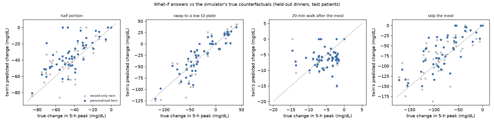
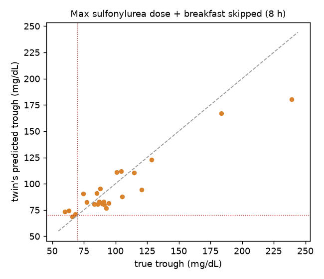

# Twin report (Phase 3): personalised ODE twin and what-if validation

_Generated by `uv run python -m twin.report` from `results/twin/` (60 synthetic test patients). This validates the twin against the simulated world only: the twin's ODE is the model that generated the data, so there is no structural model error here, unlike with real patients._

## What the twin knows
Only what a clinic would hold: the EHR record, prescriptions with reported adherence, CGM, wearable steps and the patient's own meal log (dish names and carb estimates, corrected for typical under-reporting; CGM rises with no logged meal are filled with a typical meal). It never reads the simulator's hidden state. The first 7 days personalise it (insulin sensitivity, beta-cell function and the fasting set point, starting from the record-based prior); later days test it.

## 1. Parameter recovery (Spearman correlation with the hidden true values)

| parameter | record-only prior | personalised fit |
|---|---|---|
| insulin sensitivity | 0.61 | 0.34 |
| beta-cell function | 0.58 | 0.53 |
| product (disposition) | 0.85 | 0.60 |

The fit does **not** recover the individual parameters better than the record-based prior. The prior already uses HbA1c and the fasting glucose, which carry most of the information; from CGM and an incomplete meal log, insulin sensitivity and secretion trade off against each other and against meal-size errors. The twin card therefore shows these values with their uncertainty, and the fit is judged by what it is for: predicting glucose and the effect of changes.

## 2. Fidelity on held-out days (CGM RMSE after logged meals and at night, median across patients)

| twin | RMSE (mg/dL) |
|---|---|
| record-only prior | 40.0 |
| personalised fit | 35.3 |
| oracle: true parameters, same observed inputs | 36.0 |

Most of the remaining error is in the inputs, not the parameters: unlogged or mis-sized meals and day-to-day changes in sensitivity (sleep, stress, illness) that no twin can see.

## 3. What-if answers vs true counterfactuals

For one logged dinner per patient on held-out days, the twin predicts how the 5-hour peak changes under four interventions. The truth comes from replaying the same synthetic patient with the intervention applied to the true meal, true doses and true activity. The cohort-average baseline predicts every patient's change as the average true change of the others.

| intervention | patients | median true change (mg/dL) | MAE personalised twin | MAE record-only twin | MAE cohort average | Spearman (personalised) | sign agreement |
|---|---|---|---|---|---|---|---|
| 20-min walk after the meal | 50 | -4.6 | 3.3 | 3.3 | 2.7 | 0.15 | 94 % |
| half portion | 50 | -44.6 | 13.3 | 13.0 | 15.5 | 0.68 | 94 % |
| skip the meal | 50 | -84.0 | 27.1 | 25.8 | 34.7 | 0.77 | 94 % |
| swap to a low-GI plate | 50 | -34.1 | 13.1 | 16.2 | 31.0 | 0.91 | 84 % |

The personalised twin beats both the record-only twin and the cohort average for: swap to a low-GI plate.

Systematic error of the personalised twin (predicted minus true change; negative true changes mean a lower peak): 20-min walk after the meal: -0.9 mg/dL; half portion: +9.8 mg/dL; skip the meal: +16.4 mg/dL; swap to a low-GI plate: +1.2 mg/dL. Its predicted dinner peak before any change is off by -8.7 mg/dL on average, so large meal effects are under-estimated: the twin sees smaller meals than were eaten (logged portions and unlogged extras).

## 4. Hypoglycaemia check

Scenario for every sulfonylurea user among the test patients: sulfonylurea raised to its maximum dose and breakfast skipped, 8 hours from 07:30, simulated on the twin and replayed on the true patient.

| | count |
|---|---|
| sulfonylurea users | 24 |
| true lows (< 70 mg/dL) | 4 |
| lows flagged by the twin | 1 of 4 |
| true lows at least flagged as 'caution' (< 80) | 4 of 4 |
| false low flags | 0 |
| trough error (MAE) | 11.7 mg/dL; Spearman 0.77 |

## 5. Worked examples
See [`twin_examples.md`](twin_examples.md): meal options with blocked choices and reasons, a post-dinner walk, a sulfonylurea hypoglycaemia warning, and a kidney-limited drug change on a typical day at steady state.

## Limitations
- Validated in the simulated world with a perfectly specified model; real patients add structural model error.
- The twin assumes people log about 10 % fewer carbohydrates than they eat (to verify) and fills unlogged CGM rises with a typical meal.
- Day-to-day changes in insulin sensitivity are invisible to the twin; what-if answers are for an average day for this patient.
- Drug-regimen answers compare typical days at steady state; they are not titration advice. All rules await clinical review (`docs/clinical_rules_to_review.md`).
