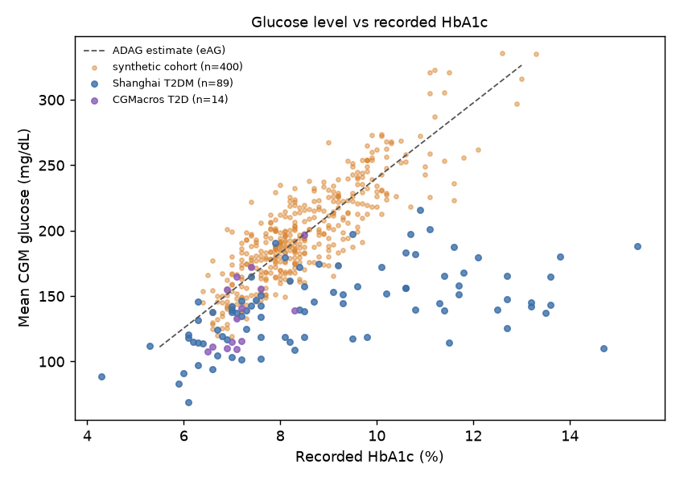
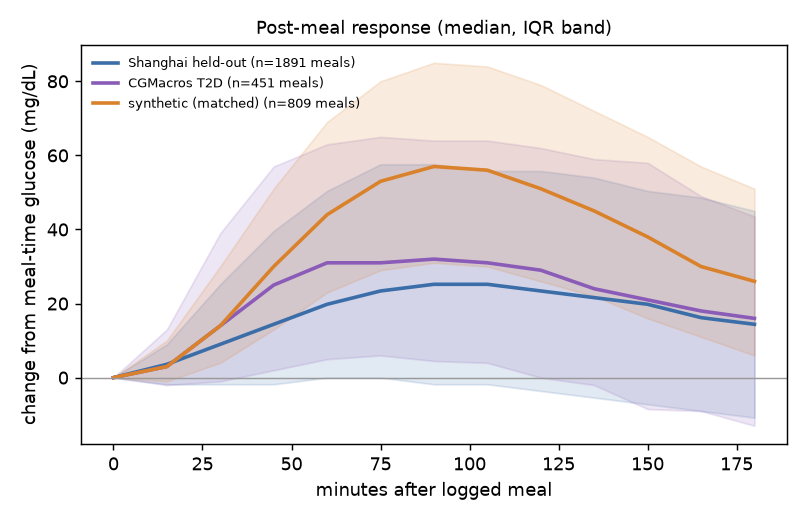
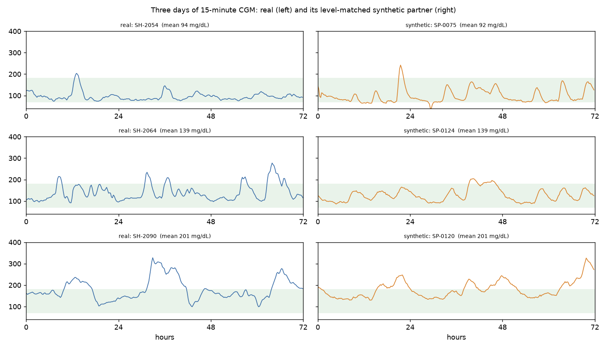

# Validation report: synthetic vs real CGM

_Generated by `uv run python -m validation.report`. Every number below comes from that run; figures and CSVs are in `results/validation/`._

Synthetic dataset: version v0.1, seed 20261020, 400 patients x 14 days. Real data (validation and calibration only, never used to train product models): Shanghai T2DM split by patient into a calibration half (48 patients) and a held-out half (49), plus CGMacros T2D participants (14) as an external set. All comparisons use 15-minute CGM, the resolution of both real datasets.

## 1. Glucose level: a deliberate difference

| set | median HbA1c (%) | median eAG from HbA1c (mg/dL) | median mean CGM (mg/dL) | median GMI (%) | slope of mean CGM on HbA1c (mg/dL per %) |
|---|---|---|---|---|---|
| Shanghai T2DM (all) | 8.40 | 194 | 142 | 6.70 | 6.1 |
| CGMacros T2D | 7.10 | 157 | 136 | 6.57 | 32.9 |
| Synthetic cohort | 8.30 | 192 | 193 | 7.92 | 26.7 |

In both real datasets the CGM recorded during the study sits below the level the recorded HbA1c implies (ADAG: eAG = 28.7 x HbA1c - 46.7): by 53 mg/dL at the median in Shanghai, where mean CGM barely rises with HbA1c (slope 6.1 mg/dL per %), and by 21 mg/dL in CGMacros, whose slope (32.9) is close to ADAG's 28.7 but offset lower (14 people only). The Shanghai recordings capture a monitored, treated period (half the patients were on insulin) rather than the 3-month average that HbA1c reflects. The synthetic cohort represents Indian outpatients whose HbA1c is current, so it is anchored to the ADAG relation on purpose. Comparing raw distributions would mostly measure this level difference, so the dynamics below are compared between real and synthetic patients **matched on mean CGM**.

Unmatched, for transparency (synthetic main cohort vs Shanghai held-out):

| metric | real_median | real_q1 | real_q3 | synthetic_median | median_gap_in_real_iqr | ks_stat |
|---|---|---|---|---|---|---|
| mean | 139 | 115 | 156 | 193 | 1.306 | 0.661 |
| gmi | 6.638 | 6.062 | 7.047 | 7.924 | 1.306 | 0.661 |
| tir_70_180 | 0.835 | 0.705 | 0.91 | 0.47 | -1.782 | 0.62 |
| cv | 0.267 | 0.237 | 0.314 | 0.248 | -0.239 | 0.211 |
| mage | 92.213 | 75.171 | 108 | 102 | 0.306 | 0.253 |
| pp_rise | 46.8 | 37.8 | 66.6 | 78.25 | 1.092 | 0.511 |
| pp_time_to_peak | 90 | 75 | 105 | 100 | 0.35 | 0.411 |
| spikes_per_day | 1.631 | 0.937 | 2.048 | 2.073 | 0.398 | 0.295 |

## 2. Level-matched dynamics

Each held-out real patient is paired with the synthetic patient (from a 300-patient pool generated with the same, calibrated configuration but a wider HbA1c range) whose mean CGM is closest. `median_gap_in_real_iqr` is (synthetic median - real median) divided by the real interquartile range; |gap| <= 0.5 means the synthetic median sits well inside the real spread. `ks_stat` is the two-sample Kolmogorov-Smirnov distance between the per-patient distributions.

**Shanghai held-out half** (metrics within 0.5 IQR: cv, mage, sd, tir_70_180, tar_180, nocturnal_to_mean, day_to_day_cv, diff_sd, diff2_sd, pp_rise, pp_time_to_peak, spikes_per_day)

| metric | real_median | real_q1 | real_q3 | synthetic_median | median_gap_in_real_iqr | ks_stat |
|---|---|---|---|---|---|---|
| cv | 0.267 | 0.237 | 0.314 | 0.258 | -0.115 | 0.163 |
| mage | 92.213 | 75.171 | 108 | 80.05 | -0.367 | 0.265 |
| sd | 35.78 | 31.338 | 44.931 | 36.305 | 0.039 | 0.122 |
| tir_70_180 | 0.835 | 0.705 | 0.91 | 0.826 | -0.043 | 0.102 |
| tar_180 | 0.141 | 0.053 | 0.215 | 0.132 | -0.054 | 0.143 |
| nocturnal_to_mean | 0.819 | 0.77 | 0.887 | 0.835 | 0.136 | 0.184 |
| day_to_day_cv | 0.107 | 0.065 | 0.171 | 0.096 | -0.099 | 0.286 |
| diff_sd | 9.636 | 7.872 | 10.714 | 8.612 | -0.36 | 0.204 |
| diff2_sd | 7.502 | 6.2 | 8.24 | 6.978 | -0.257 | 0.163 |
| pp_rise | 46.8 | 37.8 | 66.6 | 60.5 | 0.476 | 0.321 |
| pp_time_to_peak | 90 | 75 | 105 | 94.25 | 0.142 | 0.221 |
| spikes_per_day | 1.631 | 0.937 | 2.048 | 1.602 | -0.026 | 0.122 |

**CGMacros T2D, external** (metrics within 0.5 IQR: cv, sd, tir_70_180, tar_180, nocturnal_to_mean, day_to_day_cv, diff2_sd, pp_rise, spikes_per_day)

| metric | real_median | real_q1 | real_q3 | synthetic_median | median_gap_in_real_iqr | ks_stat |
|---|---|---|---|---|---|---|
| cv | 0.278 | 0.246 | 0.318 | 0.261 | -0.235 | 0.214 |
| mage | 106 | 82.883 | 123 | 84.033 | -0.54 | 0.429 |
| sd | 40.145 | 29.442 | 47.738 | 36.409 | -0.204 | 0.286 |
| tir_70_180 | 0.819 | 0.746 | 0.947 | 0.897 | 0.384 | 0.286 |
| tar_180 | 0.115 | 0.044 | 0.253 | 0.095 | -0.097 | 0.286 |
| nocturnal_to_mean | 0.835 | 0.809 | 0.918 | 0.782 | -0.487 | 0.429 |
| day_to_day_cv | 0.078 | 0.064 | 0.102 | 0.085 | 0.17 | 0.286 |
| diff_sd | 10.895 | 9.522 | 12.414 | 8.636 | -0.781 | 0.429 |
| diff2_sd | 8.307 | 7.591 | 9.083 | 7.851 | -0.305 | 0.214 |
| pp_rise | 65.75 | 44.75 | 73.125 | 52.25 | -0.476 | 0.243 |
| pp_time_to_peak | 78.75 | 73.625 | 89.375 | 88.5 | 0.619 | 0.343 |
| spikes_per_day | 1.595 | 0.946 | 2.452 | 1.452 | -0.096 | 0.143 |

For reference, the same comparison on the calibration half that the tuning saw:

| metric | real_median | real_q1 | real_q3 | synthetic_median | median_gap_in_real_iqr | ks_stat |
|---|---|---|---|---|---|---|
| cv | 0.294 | 0.254 | 0.345 | 0.278 | -0.18 | 0.229 |
| mage | 95.585 | 78.467 | 117 | 90.342 | -0.136 | 0.167 |
| sd | 40.737 | 33.298 | 53.774 | 38.569 | -0.106 | 0.208 |
| tir_70_180 | 0.841 | 0.66 | 0.894 | 0.824 | -0.074 | 0.125 |
| tar_180 | 0.151 | 0.07 | 0.332 | 0.164 | 0.05 | 0.146 |
| nocturnal_to_mean | 0.811 | 0.761 | 0.9 | 0.825 | 0.1 | 0.208 |
| day_to_day_cv | 0.143 | 0.096 | 0.192 | 0.087 | -0.58 | 0.5 |
| diff_sd | 9.736 | 7.753 | 11.245 | 9.874 | 0.039 | 0.146 |
| diff2_sd | 7.354 | 6.399 | 8.474 | 7.687 | 0.161 | 0.104 |
| pp_rise | 44.1 | 26.55 | 63.9 | 77.75 | 0.901 | 0.431 |
| pp_time_to_peak | 90 | 75 | 105 | 89 | -0.033 | 0.292 |
| spikes_per_day | 1.498 | 0.96 | 2.051 | 2.002 | 0.462 | 0.271 |

## 3. Real-vs-synthetic discriminator

LightGBM on summary features of 12-hour CGM windows, patient-grouped 5-fold cross-validation, classes balanced. Closer to 50 % accuracy / 0.5 AUC means harder to tell apart.

| comparison | windows | real patients | synthetic patients | accuracy | AUC | most useful features |
|---|---|---|---|---|---|---|
| level-matched synthetic vs held-out real | 2232 | 63 | 63 | 0.883 | 0.946 | diff_min, acf_8, diff_max, second_diff_sd |
| main synthetic cohort (unmatched) vs held-out real | 2702 | 63 | 60 | 0.919 | 0.975 | min, diff_min, mean, p10 |

The simulator is still easy to tell apart window by window. Median values of the strongest cues (level-matched run):

| feature | real | synthetic |
|---|---|---|
| diff_min | -19.8 | -14 |
| acf_8 | 0.0346 | -0.109 |
| diff_max | 25.2 | 23 |
| second_diff_sd | 7.06 | 5.61 |

`diff_min` is the steepest 15-minute fall in a 12-hour window. Real glucose falls faster after peaks than the simulator's, and not only in insulin users:

| group (Shanghai held-out half) | patients | windows | median steepest 15-min fall (mg/dL) |
|---|---|---|---|
| real, on insulin | 17 | 367 | -18.0 |
| real, no insulin | 32 | 778 | -19.8 |
| synthetic (matched) | 49 | 865 | -14.0 |

Candidate fixes for the next generator iteration: faster insulin action (p2) or a sharper meal-absorption tail, with post-peak fall rate added to the calibration targets.

## 4. TSTR: train on synthetic, test on real

CGM-only tasks (the real datasets have no wearables): glucose 30 and 60 min ahead (MAE/RMSE, mg/dL) and onset of glucose > 180 mg/dL for at least 15 min within 2 h, from windows starting at or below 180 (AUROC, PR-AUC). The TRTR row trains on the real calibration half; it is a yardstick inside `validation/` only. Each model is trained twice: on CGM history only, and with time-of-day features. Real Shanghai meals follow a hospital timetable (breakfast ~07:00, lunch ~11:00, dinner ~17:00) while the synthetic patients eat on an Indian home schedule (lunch ~13:30, dinner ~21:00), so clock features do not transfer; the CGM-history-only rows are the fair TSTR test.

- **Shanghai held-out**: 60-min MAE 19.2 mg/dL when trained on synthetic data vs 19.9 for persistence and 17.5 when trained on real data; spike PR-AUC 0.333 vs 0.282 (persistence) and 0.375 (real); AUROC 0.707 vs 0.746 and 0.772.
- **CGMacros T2D**: 60-min MAE 21.3 mg/dL when trained on synthetic data vs 22.3 for persistence and 19.4 when trained on real data; spike PR-AUC 0.328 vs 0.290 (persistence) and 0.376 (real); AUROC 0.681 vs 0.713 and 0.735.

| train | features | test | mae_30 | mae_60 | rmse_60 | spike_auroc | spike_pr_auc | spike_rate | n_samples |
|---|---|---|---|---|---|---|---|---|---|
| persistence (no training) | - | Shanghai held-out | 11.856 | 19.891 | 28.907 | 0.746 | 0.282 | 0.117 | 28400 |
| linear extrapolation (no training) | - | Shanghai held-out | 13.314 | 27.079 | 39.799 | 0.742 | 0.31 | 0.117 | 28400 |
| persistence (no training) | - | CGMacros T2D | 13.339 | 22.324 | 33.689 | 0.713 | 0.29 | 0.132 | 7169 |
| linear extrapolation (no training) | - | CGMacros T2D | 15.168 | 31.345 | 46.873 | 0.724 | 0.334 | 0.132 | 7169 |
| synthetic main cohort (train split) | CGM history only | Shanghai held-out | 11.305 | 19.2 | 27.567 | 0.707 | 0.333 | 0.117 | 28400 |
| synthetic main cohort (train split) | CGM history only | CGMacros T2D | 12.442 | 21.316 | 31.546 | 0.681 | 0.328 | 0.132 | 7169 |
| synthetic main cohort (train split) | CGM history + time of day | Shanghai held-out | 11.343 | 21.157 | 29.665 | 0.699 | 0.248 | 0.117 | 28400 |
| synthetic main cohort (train split) | CGM history + time of day | CGMacros T2D | 12.285 | 22.404 | 32.189 | 0.711 | 0.273 | 0.132 | 7169 |
| synthetic level-matched pool | CGM history only | Shanghai held-out | 10.969 | 18.799 | 27.169 | 0.702 | 0.333 | 0.117 | 28400 |
| synthetic level-matched pool | CGM history only | CGMacros T2D | 12.019 | 20.912 | 31.127 | 0.683 | 0.337 | 0.132 | 7169 |
| synthetic level-matched pool | CGM history + time of day | Shanghai held-out | 11.111 | 20.174 | 28.414 | 0.693 | 0.251 | 0.117 | 28400 |
| synthetic level-matched pool | CGM history + time of day | CGMacros T2D | 12.068 | 21.66 | 31.3 | 0.716 | 0.291 | 0.132 | 7169 |
| real Shanghai calibration half (TRTR) | CGM history only | Shanghai held-out | 10.048 | 17.512 | 25.674 | 0.772 | 0.375 | 0.117 | 28400 |
| real Shanghai calibration half (TRTR) | CGM history only | CGMacros T2D | 10.974 | 19.368 | 29.425 | 0.735 | 0.376 | 0.132 | 7169 |
| real Shanghai calibration half (TRTR) | CGM history + time of day | Shanghai held-out | 9.84 | 16.781 | 24.512 | 0.853 | 0.463 | 0.117 | 28400 |
| real Shanghai calibration half (TRTR) | CGM history + time of day | CGMacros T2D | 10.917 | 19.097 | 28.584 | 0.818 | 0.452 | 0.132 | 7169 |

## 5. Calibration

`validation/calibrate.py` searched 6 population-level settings on the Shanghai calibration half only (random search, fixed seed). Loss (weighted squared median gaps in real-IQR units) went from 41.16 with the hand-set defaults to 0.54. Chosen values (`configs/calibrated.yaml`):

| setting | value |
|---|---|
| `physiology.gut.absorption_speed_scale` | 0.8083 |
| `physiology.latent.fasting.fasting_to_mean_ratio` | 0.6507 |
| `physiology.day_to_day.si_ar_sd` | 0.1629 |
| `sensors.cgm.noise_sd_mgdl` | 1.735 |
| `sensors.cgm.noise_multiplicative_sd` | 0.01157 |
| `sensors.cgm.noise_rho` | 0.8976 |

## 6. Limitations

- Neither real dataset is Indian; Shanghai is the closest phenotype available openly. Indian-specific values in the generator are assumptions listed in `docs/parameters_to_verify.md`.
- Real meals differ from the synthetic Indian meals (small hospital portions in Shanghai; half the patients on mealtime insulin), so post-meal rise is compared but only weakly fitted.
- The synthetic cohort uses oral agents and basal insulin only; prandial and premixed insulin (common in Shanghai) are not simulated.
- Real data have no wearable streams with sleep/HRV, so the wearable layer is checked for plausibility only, not against real data.
- Matching on mean CGM removes the level difference by construction; level-dependent metrics (TIR, TAR) are therefore partly matched too.
- Everything here validates the simulator against two small datasets (tens of patients); it does not show clinical validity.
